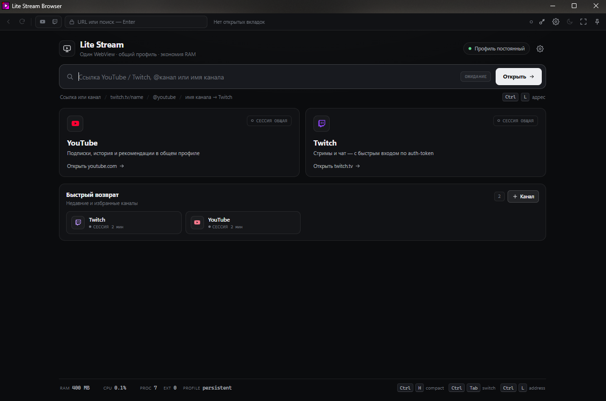
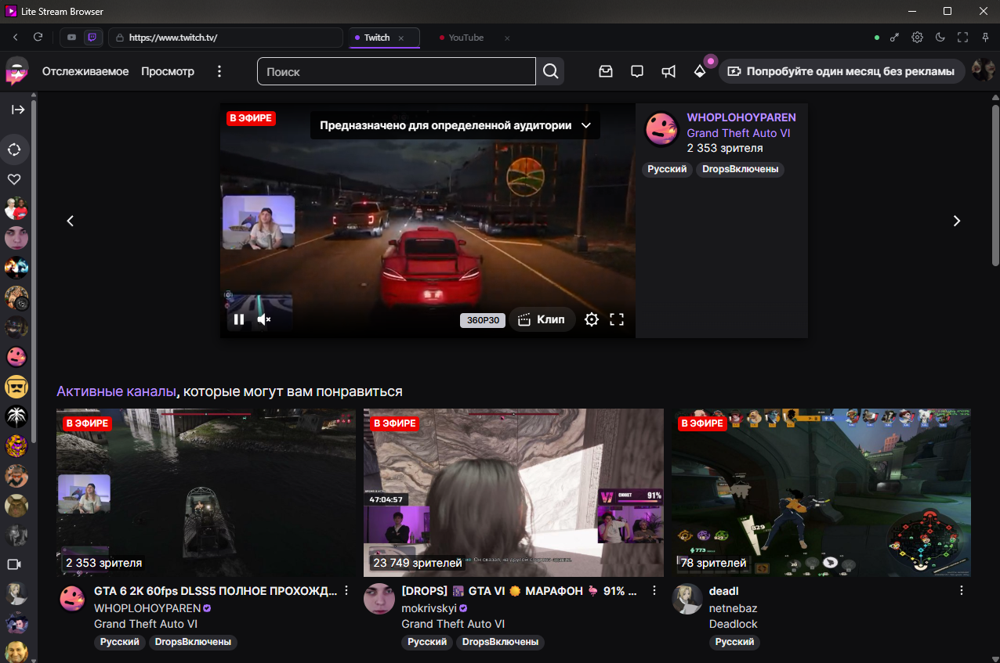
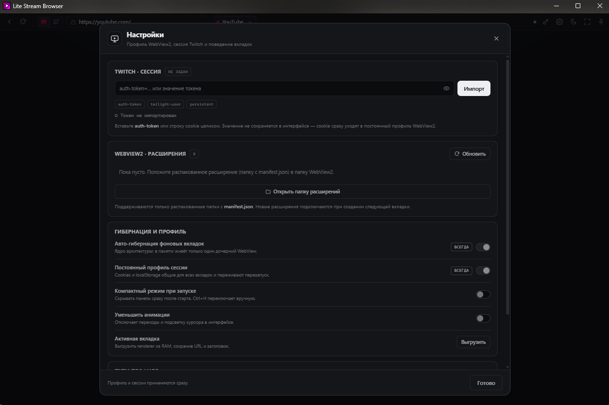

# Lite Stream Browser

Минималистичная десктопная оболочка для **YouTube** и **Twitch** на **Rust + Tauri v2**.
Без React/Vue, без сборщика фронтенда и без UI-фреймворков: интерфейс — чистые
`HTML/CSS/JS` в `ui/index.html`, а вкладками и дочерними WebView управляет Rust.

Главная идея — **в памяти живёт только одна вкладка**. При переключении, по `Ctrl+Tab`
или нажатии «Сон» дочерний WebView фоновой вкладки уничтожается вместе с процессом
рендеринга, а URL и заголовок остаются в Rust. При возврате WebView создаётся заново
с тем же постоянным профилем, поэтому страница открывается уже авторизованной.

> **UI-правила:** для любых изменений интерфейса обязателен [`AGENTS.md`](AGENTS.md)
> (Unslop) — монохромная десктопная эстетика в духе Linear/Raycast/Arc, запрет
> AI-slop/градиентов/шейдеров/тяжёлых анимаций, акценты только `#FF0033` (YouTube)
> и `#9146FF` (Twitch), анимации только `transform/opacity`.

## Скриншоты

| Домашний экран | Активная вкладка | Настройки |
| :---: | :---: | :---: |
|  |  |  |
| *Raycast-лаунчер: быстрый запуск, карточки YouTube/Twitch, быстрый возврат и живая телеметрия RAM/CPU.* | *Один активный дочерний WebView, панель 36 px, вкладки и индикатор гибернации.* | *Сессия Twitch (`auth-token`), распакованные расширения WebView2, гибернация/профиль и пути.* |

---

## Возможности

| Возможность | Как работает |
|---|---|
| **Raycast-лаунчер** | Домашний экран со строкой быстрого запуска: вставка URL, `twitch.tv/name`, `@канал` YouTube или имя канала → открытие нужной цели (Enter) с автоопределением типа |
| **+ YouTube / + Twitch** | Быстрые кнопки на панели, док платформ и крупные карточки на домашнем экране создают/открывают вкладки в общем профиле |
| **Быстрый возврат** | Недавние вкладки (автозапоминание) и избранные каналы: 4 карточки по умолчанию с раскрытием, статусы `Active` / `Hibernated` / `Saved Session`, относительное время, удаление и добавление |
| **Живая телеметрия** | Нижняя плашка домашнего экрана показывает RAM, CPU, число процессов (`Proc`), количество расширений (`Ext`) и метку профиля; замеры берутся по дереву процессов приложения (`get_runtime_stats`) |
| **Единый профиль** | Все дочерние WebView используют одну папку `data_directory`, поэтому cookies, логины, подписки, рекомендации и `localStorage` общие |
| **Сон вкладки** | Закрывает child WebView, сохраняя URL/заголовок в `AppState` под `Mutex`; при пробуждении страница открывается заново в том же профиле |
| **Переключение вкладок** | Текущий WebView уничтожается, целевой создаётся лениво из сохранённого URL; `Ctrl+Tab` циклически переключает вкладки с авто-гибернацией (`cycle_tab`) |
| **Адресная строка** | Навигация к URL/домену/запросу; быстрый фокус — `Ctrl+L` |
| **Назад / Обновить** | `history.back()` и нативная перезагрузка WebView |
| **Поверх всех окон** | `set_always_on_top` у главного окна |
| **Компактный плеер** | `Ctrl+H` скрывает панель 36 px и растягивает WebView на 100% высоты (повторное нажатие возвращает панель) |
| **Настройки (overlay)** | Секции: сессия Twitch, распакованные расширения WebView2, гибернация/профиль (ядро всегда включено + локальные опции UI), пути профиля; открываются по `Ctrl+,`/иконке и временно скрывают активный дочерний WebView (`set_webview_visible`) |
| **Авторизация** | Нативный User-Agent системного WebView2 с актуальным Chromium + постоянный профиль; Edge/WebView2-токены и Client Hints нормализуются до Google Chrome |
| **Импорт сессии Twitch** | В настройках: вставка `auth-token` (или строки cookie) с маскированием, статусом/датой и превью имён cookie; значение токена не логируется и не сохраняется в `localStorage` (только факт импорта/дата/имена cookie), cookie уходят в профиль WebView2 |
| **Расширения WebView2** | Поддерживаются распакованные Chrome/Edge-расширения из постоянной папки `extensions`; список/обновление и открытие папки — в настройках, установка идёт через профиль WebView2 с дедупликацией |
| **Попапы** | `target="_blank"` и OAuth-попапы открываются как обычные вкладки в том же профиле |

---

## Как устроена экономия памяти

Главное окно Tauri содержит **основной WebView** (панель вкладок) и **один дочерний
WebView** активной вкладки, который располагается ровно под панелью:

```
┌──────────────────────────────────────────────────────────────────┐
│  main WebView (HTML/CSS/JS) — панель 36 px                       │
│  [←] [↻] [YT/TW] [адрес] [вкладки…] [hib] [🔑] [⚙] [☾] [⤢] [📌]  │
├──────────────────────────────────────────────────────────────────┤
│                                                                  │
│  child WebView активной вкладки                                  │
│  (YouTube / Twitch / любой URL)                                  │
│                                                                  │
└──────────────────────────────────────────────────────────────────┘
```

* Панель и домашний экран рендерятся в основном WebView.
* Дочерний WebView создаётся через `Window::add_child` (фича `unstable`).
* Его позиция — `(0, 36 × scale_factor)`, размер — вся оставшаяся область окна.
* При ресайзе окна и смене DPI Rust пересчитывает геометрию (`apply_layout`).
* Пока вкладок нет, отображается домашний экран (Raycast-лаунчер) в основном WebView;
  при открытии любой вкладки он скрывается, а дочерний WebView занимает всё пространство
  ниже панели без наложений. Оверлей настроек при необходимости временно скрывает
  активный дочерний WebView через `set_webview_visible`.
* В один момент существует **максимум один** дочерний WebView.

Жизненный цикл вкладки:

```
открыть/переключить
        │
        ▼
  ┌─────────────┐   переключение / «Сон»   ┌─────────────┐
  │  Awake      │ ───────────────────────► │  Sleeping   │
  │ child WV    │                          │ нет WV      │
  │ в памяти     │ ◄─────────────────────── │ URL+title   │
  └─────────────┘   клик / «Разбудить»     └─────────────┘
                         add_child(data_directory, saved_url)
```

Состояние лежит в `Arc<Mutex<AppState>>`:

```rust
pub struct AppState {
    pub tabs: Vec<Tab>,              // id, title, url, sleeping, webview_label
    pub active: Option<u64>,
    pub compact: bool,
    pub always_on_top: bool,
    pub data_directory: PathBuf,     // общий профиль всех вкладок
    pub extensions_directory: PathBuf,// распакованные расширения WebView2
}
```

Команды Tauri — `async`, потому что создание WebView на Windows нельзя выполнять
в синхронной команде или обработчике события: WebView2 может заблокироваться.
Обработчик `on_new_window` для этого явно запускает отдельный поток.

---

## Структура проекта

```
lite-stream-browser/
├── Cargo.toml                     # workspace + release-профиль
├── Cargo.lock
├── README.md
├── AGENTS.md                      # Unslop: обязательные правила UI/дизайна и инварианты
├── .gitignore
├── ui/
│   └── index.html                 # панель, Raycast-лаунчер, настройки, телеметрия: HTML + CSS + JS
└── src-tauri/
    ├── Cargo.toml                 # tauri = { features = ["unstable"] }, windows (метрики)
    ├── build.rs
    ├── tauri.conf.json            # окно, identifier, withGlobalTauri
    ├── capabilities/
    │   └── default.json           # core:default / core:event:default
    ├── icons/
    │   ├── icon.ico
    │   └── icon.png
    └── src/
        ├── main.rs                # точка входа
        ├── lib.rs                 # Builder, шорткаты Ctrl+H/Ctrl+Tab, окно, пути профиля/расширений
        ├── state.rs               # AppState / Tab / снапшот для UI
        ├── browser.rs             # add_child, layout, hibernate, UA, установка расширений
        ├── commands.rs            # Tauri-команды, URL, Twitch-токен, расширения, cycle/visibility/metrics
        └── metrics.rs             # замер RAM/CPU/процессов по дереву приложения (Windows)
```

---

## Требования

* **Windows 10/11** (проект в первую очередь рассчитан на WebView2).
* **Rust** 1.77.2 или новее.
* **Microsoft Edge WebView2 Runtime** — обычно уже установлен в Windows 10/11.
* Node.js и npm **не нужны**: фронтенд статический.
* Tauri CLI нужен только для `cargo tauri dev/build`; для запуска достаточно `cargo run`.

---

## Запуск

Из корня проекта:

```powershell
cargo check          # проверка типов
cargo run            # сборка и запуск приложения
```

Либо из папки `src-tauri`:

```powershell
cd src-tauri
cargo run
```

Через Tauri CLI (опционально):

```powershell
cargo install tauri-cli --version "^2"
cargo tauri dev
cargo tauri build
```

> В `tauri.conf.json` стоит `"bundle": { "active": false }`, поэтому
> `cargo tauri build` соберёт исполняемый файл без установщика. Для MSI/NSIS
> включите `bundle.active`, добавьте полный набор иконок и укажите цели сборки.

Проверено с `tauri 2.12.7`, `tauri-plugin-global-shortcut 2.4.1`, Rust 1.100.0:
`cargo check` завершается успешно.

---

## Авторизация и постоянная сессия

Все дочерние WebView получают одну и ту же папку:

```text
%LOCALAPPDATA%\com.litestream.browser\browser-profile
```

Это стандартная папка пользовательских данных WebView2 (`data_directory`). Рядом
с ней приложение создаёт папку распакованных расширений:

```text
%LOCALAPPDATA%\com.litestream.browser\extensions
```

Точные пути отображаются в **Настройках → Пути профиля**. Первая вкладка
устанавливает найденные расширения в профиль WebView2; новые папки могут
отображаться как ожидающие, пока не создан child WebView.

Профиль общий для всех вкладок и сохраняется между запусками, поэтому:

* вход в Google/YouTube и Twitch сохраняется;
* подписки, история просмотров и персональные рекомендации не теряются;
* после «сна» вкладка открывается уже авторизованной;
* cookies и `localStorage` доступны всем вкладкам.

User-Agent **не фиксируется в коде**: используется нативный UA установленного
системного WebView2, поэтому версия Chromium всегда актуальная (140+). Чтобы Google и
Twitch не воспринимали встроенный движок как неподдерживаемый браузер, при старте
каждой вкладки:

* в WebView2 передаётся `--disable-blink-features=AutomationControlled` (вместе с
  дефолтными `--disable-features` от wry);
* сразу после создания дочернего WebView через `with_webview` читается нативный
  `ICoreWebView2Settings2::UserAgent`, из него удаляются `Edg/...`, `Edge/...` и
  любые токены `WebView2`, а результат записывается обратно через `SetUserAgent`.
  Поэтому **сетевой** заголовок `User-Agent`, который проверяет
  `passport.twitch.tv`, тоже выглядит как обычный Chrome с реальной версией
  Chromium;
* `initialization_script` выполняется до скриптов страницы и:
  * скрывает `navigator.webdriver` (возвращает `undefined`);
  * удаляет из `navigator.userAgent` только токены `Edg/...`, `WebView2/...` и
    `Microsoft Edge WebView2`, сохраняя реальную версию `Chrome/<версия>`;
  * заменяет бренды `navigator.userAgentData.brands` на `Google Chrome` +
    `Chromium` с реальной major-версией движка и приводит к ним же
    `getHighEntropyValues()`.

Итоговый UA выглядит как обычный Windows Chrome, но его версия берётся из
установленного WebView2, а не из захардкоженной строки.

**Как войти:** откройте YouTube или Twitch, нажмите «Войти» и авторизуйтесь как в
обычном браузере. Сессия сохранится автоматически.

**Сбросить профиль:** закройте приложение и удалите папку `browser-profile`.

> Google иногда ограничивает вход в сторонних embedded-браузерах. Реалистичный UA
> решает большинство случаев, но политика Google может меняться.

## Вход в Twitch по токену

Форма логина Twitch (`passport.twitch.tv`) дополнительно прогоняет браузер через
integrity-check и даже с чистым сетевым `User-Agent` может отвечать «Ваш браузер пока
не поддерживается». Обходить проверку не нужно: сессию можно один раз перенести из
обычного браузера.

1. Войдите в Twitch в Chrome/Firefox/Edge.
2. Откройте DevTools → **Application → Cookies → `https://www.twitch.tv`** и скопируйте
   значение cookie `auth-token` (или всю строку вида
   `auth-token=...; twilight-user=...; persistent=...`).
3. В приложении откройте **Настройки** (`Ctrl+,` или кнопка/иконка ключа на панели) →
   секция **«Twitch · сессия»**.
4. Вставьте значение в поле токена и нажмите **«Импорт»** (или `Enter`). Поле
   маскируется (можно показать/скрыть), отображаются статус, дата импорта и имена
   обнаруженных cookie. `Esc` закрывает настройки.

Что происходит дальше:

* команда `import_twitch_token` разбирает ввод (голое значение токена или строка
  cookie) и оставляет только `auth-token`, `twilight-user`, `persistent`;
* если активна не Twitch-вкладка, приложение находит существующую вкладку Twitch или
  открывает `https://www.twitch.tv`;
* через `with_webview` → `ICoreWebView2_2::CookieManager` создаются cookie для
  `.twitch.tv`, путь `/`, `IsSecure = true`, `IsHttpOnly = false`,
  `SameSite = NONE` и сроком действия +1 год;
* после подтверждения записи вкладка Twitch перезагружается и открывается уже
  авторизованной.

Cookie живут в постоянном `data_directory` (`browser-profile`), поэтому импорт нужен
только один раз — при следующих запусках сессия восстанавливается сама. Если токен
недействителен, Twitch сам удалит cookie при загрузке страницы — это ожидаемо.

> В интерфейсе значение токена не логируется и не сохраняется в `localStorage`
> (хранится только факт импорта, дата и имена cookie) — оно сразу уходит в профиль
> WebView2. Оверлей настроек рисуется поверх страницы, поэтому на время открытия
> активный дочерний WebView временно скрывается (`set_webview_visible`).

---

## Расширения WebView2

Приложение включает поддержку распакованных Chrome/Edge-расширений в дочерних
WebView2:

* при создании вкладки `WebviewBuilder` получает
  `.browser_extensions_enabled(true)` (это включает
  `ICoreWebView2EnvironmentOptions::SetAreBrowserExtensionsEnabled(true)` в wry);
* постоянная папка расширений: `%LOCALAPPDATA%\com.litestream.browser\extensions`;
* сканируются только **подпапки верхнего уровня**, в которых есть `manifest.json`;
* установка выполняется вручную через
  `ICoreWebView2Profile7::AddBrowserExtensionAsync` (через
  `profile.cast::<ICoreWebView2Profile7>()?`) после `add_child`, чтобы избежать
  дублей и лишних попыток;
* для дедупликации используется реестр `<extensions>\.installed.json`
  (канонический путь папки + id/имя); перед установкой он сверяется с
  `GetBrowserExtensionsAsync`;
* если были добавлены новые расширения, активная вкладка перезагружается один
  раз — WebView2 применяет их при следующей навигации.

Команды Tauri:

* `open_extensions_folder` — создаёт папку `extensions` (если её нет) и
  открывает её в Проводнике Windows (`explorer.exe`);
* `list_extensions` — возвращает список папок-расширений (`name`, `version`,
  `path`, `id`, `status`) для домашнего экрана. Если child WebView уже создан,
  список объединяется с живыми данными профиля (`active` / `disabled`).

Как добавить `uBlock Origin`, `7TV`, `SponsorBlock`:

1. Скачайте **распакованную** версию расширения (папку с `manifest.json`), а не
   `.crx`/`.zip`.
2. Откройте **Настройки** (`Ctrl+,`) → секция **«WebView2 · расширения»** и нажмите
   **«Открыть папку расширений»** (либо откройте `%LOCALAPPDATA%\com.litestream.browser\extensions` вручную).
3. Скопируйте папку расширения в `extensions` (каждое расширение — отдельная
   подпапка верхнего уровня).
4. Нажмите **«Обновить»** в настройках и откройте новую вкладку (или перезапустите
   приложение). Новые расширения установятся в профиль при создании вкладки.

Ограничения: расширения устанавливаются только в профиле дочерних вкладок
(основной WebView панели использует отдельный data dir и расширения в нём
отключены). UI-попапы расширений, магазин Chrome Web Store и автообновления не
поддерживаются — только локальные unpacked-папки.

---

## Управление

| Действие | Элемент / клавиша |
|---|---|
| Быстрый запуск (Raycast-строка) | центральная строка на домашнем экране: URL, `twitch.tv/name`, `@канал` YouTube или имя канала + `Enter` |
| Открыть YouTube / Twitch | док платформ/кнопки на панели 36 px или карточки на домашнем экране |
| Быстрый возврат | карточки недавних (авто) и избранных: клик — открыть/переключить, добавление/удаление (избранное и недавние сохраняются в `localStorage`) |
| Открыть настройки | `Ctrl+,` или кнопка настроек (⚙) на панели/домашнем экране |
| Импорт сессии Twitch | **Настройки → Twitch · сессия** (также кнопка ключа на панели): вставка `auth-token`/cookie → «Импорт» / `Enter` |
| Расширения WebView2 | **Настройки → WebView2 · расширения**: список, «Обновить», «Открыть папку расширений» |
| Открыть URL / перейти / найти | адресная строка панели + `Enter` |
| Фокус в адресную строку | `Ctrl+L` |
| Назад | кнопка `←` |
| Обновить | кнопка `↻` (`Ctrl+R` / `F5` — при фокусе на панели) |
| Переключить вкладки по кругу | `Ctrl+Tab` (следующая вкладка, с авто-гибернацией предыдущей) |
| Усыпить / разбудить активную вкладку | кнопка `☾`/`☀` (также «Выгрузить» в настройках или клик по спящей вкладке) |
| Показать/скрыть панель 36 px (компакт) | **`Ctrl+H`** или кнопка `⤢` |
| Поверх всех окон | кнопка `📌` |
| Закрыть вкладку | `×` на вкладке; `Delete` / `Backspace` при фокусе на вкладке |
| Переключить вкладку мышью/клавиатурой | клик по вкладке; `Enter`/`Space` при фокусе на вкладке |
| Закрыть настройки/форму | `Esc` |

`Ctrl+H` и `Ctrl+Tab` регистрируются как глобальные hotkey **только пока окно
приложения в фокусе** (при потере фокуса снимаются). Это позволяет использовать их,
когда фокус находится внутри дочернего WebView YouTube/Twitch, и не отбирать
сочетания у других программ.

---

## Где что менять

| Что | Файл |
|---|---|
| Правила UI/дизайна (Unslop) | `AGENTS.md` (обязательно для любых изменений `ui/index.html` и нового UI-кода) |
| Высота панели | `PANEL_HEIGHT` в `src-tauri/src/browser.rs` и `--bar` в `ui/index.html` |
| Интерфейс: панель, Raycast-лаунчер, быстрый возврат, настройки, телеметрия | `ui/index.html` (HTML/CSS/JS, inline SVG, без фреймворков) |
| Шорткаты и их регистрация по фокусу окна | `Ctrl+H`/`Ctrl+Tab` в `src-tauri/src/lib.rs`; обработка `Ctrl+L`, `Ctrl+,`, `Alt+←`, `Ctrl+R`/`F5` в `ui/index.html` |
| Циклическое переключение вкладок | `cycle_tab` / `cycle_tab_sync` в `src-tauri/src/commands.rs`, регистрация в `src-tauri/src/lib.rs` |
| Скрытие/показ дочернего WebView (для оверлеев) | `set_webview_visible` в `src-tauri/src/commands.rs`, вызов из `ui/index.html` |
| Живая телеметрия RAM/CPU/Proc | `get_runtime_stats` в `src-tauri/src/commands.rs`, замер в `src-tauri/src/metrics.rs` |
| Аргументы WebView2, сетевой User-Agent и JS-нормализация Client Hints | `BROWSER_ARGS`, `apply_clean_user_agent`, `INITIALIZATION_SCRIPT` в `src-tauri/src/browser.rs` |
| Расширения: сканирование, установка, дедупликация, список | `sync_extensions`, `add_extensions`, `collect_extensions` в `src-tauri/src/browser.rs`; команды `open_extensions_folder`, `list_extensions` в `src-tauri/src/commands.rs` |
| Импорт Twitch-сессии, домен/флаги/срок cookie | `import_twitch_token` в `src-tauri/src/commands.rs`, `install_twitch_cookies`/`set_twitch_cookies` в `src-tauri/src/browser.rs` |
| Папка профиля и папка расширений | `app_local_data_dir()/browser-profile`, `app_local_data_dir()/extensions` в `src-tauri/src/lib.rs` |
| Права Tauri | `src-tauri/capabilities/default.json` |
| Размеры/заголовок окна | `src-tauri/tauri.conf.json` |

---

## Правила UI (Unslop)

Любые изменения интерфейса (`ui/index.html`, стили, новые UI-элементы) должны
соответствовать [`AGENTS.md`](AGENTS.md):

* **Стек:** Rust + Tauri v2 + WebView2 + vanilla HTML/CSS/JS. Без React/Vue,
  без Tailwind CDN, без сборщика и без иконочных шрифтов (только inline SVG).
* **Эстетика:** нативный десктоп-лаунчер (Linear/Raycast/Arc), монохромная палитра
  (`#0B0C0E` фон, `#111215` поверхности, `#181A1F/#1F2228` hover), границы
  `1px solid rgba(255,255,255,0.08/0.16)`.
* **Акценты:** только функциональные — YouTube `#FF0033`, Twitch `#9146FF`
  (маркеры платформы/вкладок/иконок); статусы — приглушённые `#5ED68A/#E0B25C/#FF6B6B`
  точками/чипами.
* **Zero-bloat:** анимации только `transform`/`opacity` (150–220 ms,
  `cubic-bezier(0.2,0,0,1)`), без blur/шейдеров/тяжёлых эффектов; пауза
  анимаций/таймеров в compact/sleep/hidden и уважение `prefers-reduced-motion`.
* **Инварианты:** один живой дочерний WebView, `PANEL_HEIGHT` = `--bar` = 36 px,
  сохранение существующих Tauri-команд, оверлеи поверх страницы только через
  `set_webview_visible`, токен Twitch не логируется и не сохраняется в `localStorage`.

---

## Технические детали

* `tauri = { features = ["unstable"] }` — обязательное условие для
  `WebviewBuilder` / `Window::add_child`.
* `additional_browser_args` заменяет дефолтные аргументы wry, поэтому
  `--disable-features=msWebOOUI,msPdfOOUI,msSmartScreenProtection` продублирован
  рядом с `--disable-blink-features=AutomationControlled`.
* `apply_clean_user_agent` через `with_webview` получает
  `ICoreWebView2Controller -> CoreWebView2 -> Settings -> ICoreWebView2Settings2`,
  читает нативный `UserAgent`, вырезает `Edg/...`/`WebView2` и записывает строку
  обратно через `SetUserAgent`. Это очищает и сетевой HTTP-заголовок, и
  `navigator.userAgent`, сохраняя версию Chromium установленного WebView2.
* `initialization_script` дополнительно скрывает `navigator.webdriver` и
  нормализует Client Hints (`navigator.userAgentData.brands`) до
  `Google Chrome`/`Chromium`.
* `WebviewBuilder::browser_extensions_enabled(true)` включает поддержку расширений
  в окружении WebView2. Сами распакованные расширения устанавливаются вручную в
  `create_child` через `ICoreWebView2Profile7::AddBrowserExtension` (канал
  `mpsc` + `ProfileAddBrowserExtensionCompletedHandler`, т.к. обработчики
  выполняются на UI-потоке WebView2). Список для UI берётся из сканера папки и,
  при наличии живого WebView, из `GetBrowserExtensions`.
* Для COM-вызовов используются `webview2-com` и `windows-core` — обе библиотеки
  уже присутствуют в графе зависимостей wry/Tauri, новых тяжёлых крейтов нет.
* `install_twitch_cookies` отправляет запись в `with_webview` и ждёт подтверждения
  через `std::sync::mpsc` (таймаут 15 с), поэтому `reload()` вызывается только после
  того, как `AddOrUpdateCookie` реально завершился. `AddOrUpdateCookie` синхронный,
  `CreateCookie` — нет; цепочка интерфейсов:
  `ICoreWebView2 -> cast::<ICoreWebView2_2>() -> CookieManager()`.
* Значение cookie из инпута не логируется и не сохраняется в `AppState` — оно сразу
  уходит в WebView2, а дальше живёт в зашифрованном cookie-хранилище профиля
  (`...\browser-profile\EBWebView\Default\Network\Cookies`).
* `on_page_load` сохраняет актуальный URL, `on_document_title_changed` — реальный
  заголовок страницы. Оба колбэка обновляют `AppState` и отправляют событие
  `state-changed` в основной WebView.
* Каждому WebView выдаётся уникальный label вида `tab-<id>-<generation>`.
  Это защищает от коллизии, если WebView2 ещё асинхронно уничтожает старый view.
* Все обращения к WebView выполняются **без удержания мьютекса**: блокировки
  снимаются до `add_child`, `close`, `set_size` и `navigate`, поэтому колбэки
  заголовка/загрузки не могут вызвать дедлок.
* Координаты дочернего WebView считаются в физических пикселях:
  `36 * scale_factor`, что сохраняет высоту панели на HiDPI-экранах.
* Одновременно живёт только один дочерний WebView — это главный механизм
  экономии RAM/CPU.

---

## Известные ограничения

* Интерфейс панели и домашнего экрана на русском языке.
* Поддерживаются только **распакованные** (unpacked) расширения из локальной папки
  `extensions`; Chrome Web Store, `.crx`, UI-попапы расширений и автообновления
  не реализованы. Расширения подключаются к профилю дочерних вкладок.
* Новые папки расширений устанавливаются при создании вкладки (когда WebView2 уже
  создал профиль), поэтому до первой вкладки/обновления их статус в настройках может
  быть «ожидает».
* Нет закладок/истории как отдельной подсистемы (кроме блока «Быстрый возврат» —
  недавние и избранные на домашнем экране), нет менеджера загрузок.
* Google может периодически требовать подтверждение входа в embedded-браузере.
* DRM-видео (например, некоторые платные сервисы) может не поддерживаться WebView2.
* Профиль общий для всех вкладок: выход из аккаунта в одной вкладке затрагивает все.
* `bundle.active = false` — установщики нужно настраивать отдельно. Релизный
  исполняемый файл собирается как `target\release\lite-stream-browser.exe`.
